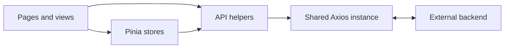

# Tagma CRM

A Vue 3 frontend for managing trade outlets, sales workflows, and distribution operations.

**Stack:** Vue 3 · TypeScript · Vite · Pinia · Vue Router · Axios · Element Plus · Tailwind CSS

## Overview

Tagma CRM is a working client application for trade and distribution operations. This public repository represents its frontend; authenticated workflows require a compatible backend, which is not included.

**Four implementations to explore:**

- Configurable, reusable forms, tables, and filters.
- Multi-step promotion selection.
- Grouped sales-report transformation.
- Drag-and-drop route ordering with explicit API submission.

See [Engineering Challenges](#engineering-challenges) for source evidence.

## My Contribution

I developed the complete frontend for Tagma CRM as a real client project, covering application architecture, reusable UI components, business workflows, state management, API integration, localization, and reporting interfaces.

The production repository is private. This public version is maintained as a portfolio-safe representation of the frontend, with client-sensitive configuration and business data excluded.

## Screenshots

Captures are pending. Prioritize **Total Sales → Promotion builder → Route ordering**, using synthetic data. Follow the [six-screen capture guide](docs/screenshots/README.md); no images are included yet.

## Engineering Challenges

| Challenge | Implementation evidence |
| --- | --- |
| Reusing UI across modules | [Field-driven forms](src/views/Dynamic/add.vue) render configured controls and accept validation rules. [Named table slots](src/components/Table/TwTable.vue) customize cells, while [filter definitions](src/components/filter/horizontalFilter.vue) select input, date, or select controls. |
| Coordinating multi-step promotion selection | The [promotion builder](src/views/Promotions/AddPromotions.vue) shares Pinia state across steps. [Group-selection watchers](src/views/Promotions/components/step-2.vue) synchronize product IDs; switching selection modes clears incompatible choices. |
| Transforming daily sales records | [Total Sales](src/pages/TotalSales.vue) derives day columns, normalizes missing daily values to zero, groups products, calculates subtotals and overall totals, and merges group cells. |
| Submitting reordered outlet visits | The [route-ordering screen](src/pages/routeOrders.vue) receives updated lists from a draggable component. Its [store](src/store/routeOrders.ts) explicitly submits the ordered list with the selected agent and weekday. |

## Key Features

- **Outlet and catalog maintenance:** product records, trade channels, outlet contacts, photos, equipment, and notes.
- **Order and sales review:** filters, pagination, status/payment summaries, sales plans, grouped reports, and backend-generated spreadsheet downloads.
- **Promotion configuration:** staged discount and promotion forms with product selection.
- **Distribution coordination:** sales-team records, route assignments, and outlet visit ordering.

## Technical Highlights

- TypeScript interfaces describe domain records and UI contracts; Composition API state and computed values drive rendering.
- Shared tables provide custom cells, loading placeholders, and empty states; dialogs support configured fields and Element Plus validation.
- Axios interceptors attach bearer-token and language headers, display request errors, and redirect HTTP 401 responses to login.
- Russian and Turkmen labels and messages use Vue I18n. Element Plus controls combine with Tailwind utilities and SCSS styling.

## Architecture

Pages compose shared components and domain views. Pinia stores manage queries, forms, and data operations; some pages call API helpers directly. Responses update reactive UI state. Vue Router lazy-loads screens within a shared layout.



## Project Structure

```text
src/
├── pages/        Route-level screens
├── views/        Domain forms and detail sections
├── components/   Reusable UI
├── store/        Domain state and actions
├── api/          Request helpers
└── types/        Domain and UI contracts
```

Routing, translation catalogs, and shared Axios configuration live in `src/router/`, `src/i18n/`, and `src/utils/request.ts`.

## Getting Started

Use Node.js 20+ and npm. From the repository root:

```sh
npm ci --registry=https://registry.npmjs.org --replace-registry-host=always
```

The registry options accommodate lockfile mirror URLs without changing pinned versions or integrity checks. Create `.env.local` using the examples below, then run `npm run dev` (port **8000**). Business data requires a configured backend and valid account.

| Command | Purpose |
| --- | --- |
| `npm run build` | Type-check and build in parallel |
| `npm run build-only` | Build assets into `dist/` |
| `npm run preview` | Serve the frontend after building |
| `npm run type-check` | Check Vue/TypeScript with `vue-tsc` |
| `npm run lint` | Run ESLint |

No automated test suite is currently configured.

## Security / Configuration

Example values for the API, images, and application base path:

```dotenv
VITE_APP_BASE_URL=https://api.example.com/
VITE_APP_IMAGE_URL=https://cdn.example.com/
VITE_APP_PREFIX_BASE_URL=/
```

`.env.local` is ignored by Git. **Vite exposes `VITE_*` values to the browser; never store secrets in them.**

Tokens and roles are stored in localStorage. Route guards check token presence; admin-only visibility is a client-side UI restriction, not backend access enforcement. Keep real configuration, credentials, personal details, and business data out of public captures.
