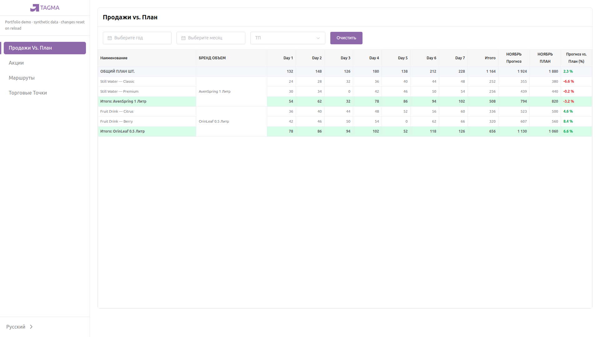
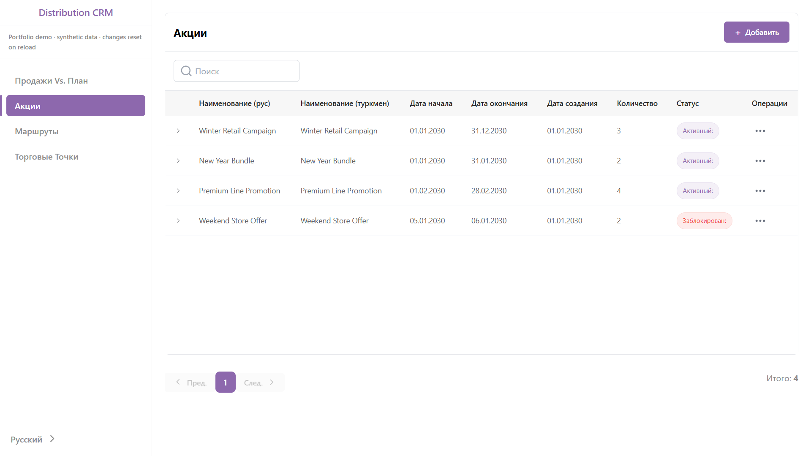
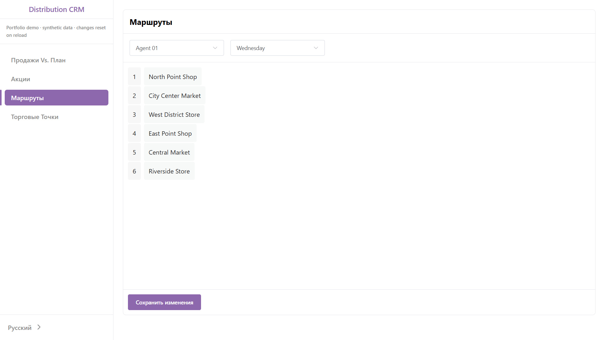
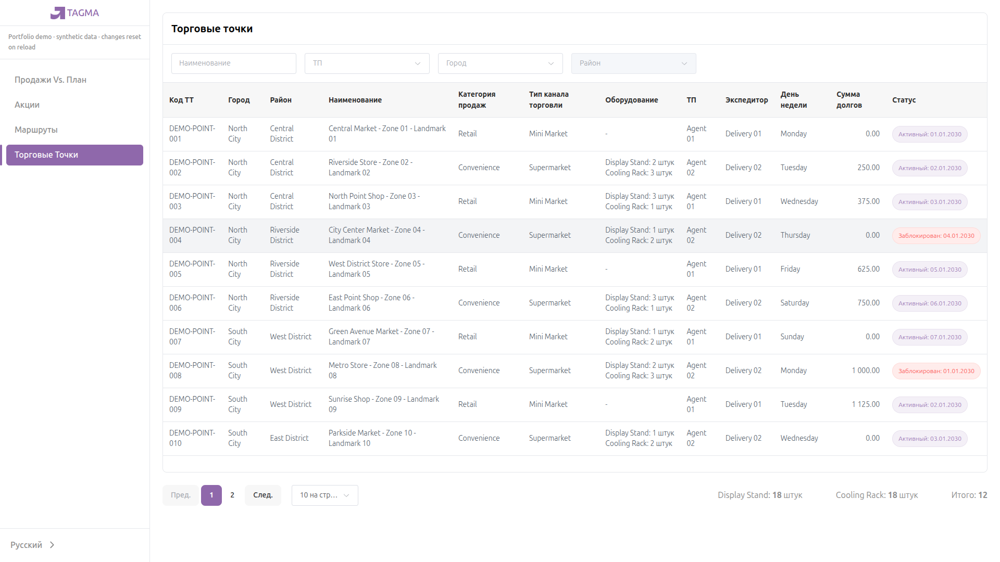

# Tagma CRM

A Vue 3 frontend for managing trade outlets, sales workflows, and distribution operations.

**Stack:** Vue 3 · Vite · TypeScript · Pinia · Vue Router · Vue I18n · Element Plus · Tailwind CSS · Axios

## Overview

Tagma CRM is based on a working client application for trade and distribution operations. Four workflows represent the frontend: **Total Sales, Promotion Builder, Route Ordering, and Outlets**. Engineering examples include configurable UI, dependent selection state, report transformation, and explicit submission of reordered visits.

## My Contribution

I developed the complete frontend for Tagma CRM as a real client project, covering application architecture, reusable UI components, business workflows, state management, API integration, localization, and reporting interfaces.

Backend services were developed separately and are not included. The production repository is private; this public repository is a portfolio-safe frontend representation with client-sensitive configuration and business data excluded.

## Live Demo

Live demo deployment pending.

The portfolio demo uses fictional synthetic data, contains no client credentials, and does not connect to the client backend. Promotion creation and route saves persist in memory until reload; this demo is separate from the production application.



**Total Sales:** the [report transformation](src/pages/TotalSales.vue) derives daily columns from returned records, normalizes missing days to zero, groups products, merges group cells, and calculates subtotals and overall totals alongside forecast versus plan comparisons. The demo provides seven synthetic days.

## Engineering Challenges

### Configurable forms, tables, and filters

[Field-driven forms](src/views/Dynamic/add.vue) render configured controls with Element Plus validation rules. [TwTable](src/components/Table/TwTable.vue) exposes named cell slots, loading placeholders, and an empty state. [HorizontalFilter](src/components/filter/horizontalFilter.vue) renders input, select, or date controls from field definitions, reusing query controls across screens.

### Multi-step Promotion Builder

The [builder](src/views/Promotions/AddPromotions.vue) shares Pinia state across campaign details and product selection. [Selection watchers](src/views/Promotions/components/step-2.vue) synchronize group choices with product IDs; switching Single / Group modes clears incompatible selections. Creation uses the existing store/API flow, with in-memory responses in demo mode.



The seeded list is shown above; see [campaign details](docs/screenshots/promotion-builder1.png) and [product selection](docs/screenshots/promotion-builder2.png).

### Drag-and-drop Route Ordering

The [route screen](src/pages/routeOrders.vue) filters visits by agent and weekday. Dragging updates the list; the [store](src/store/routeOrders.ts) submits its order only when Save is clicked. Demo saves retain separate orders per agent/day in memory and reset on reload.



### Read-only Outlets

[PointsTable](src/views/Points/PointsTable.vue) customizes reusable table slots for outlet information, equipment, status, and debt. The [page](src/pages/Point/Points.vue) combines name search, agent/city filters, dependent district options, and pagination. Its existing Pinia/API flow serves 12 synthetic outlets; demo administration and detail navigation are disabled.



## Architecture

TypeScript interfaces define records and UI contracts; Composition API computed values drive rendering. Pages compose domain views and shared components. Pinia stores manage forms, queries, and requests; some pages call API helpers directly. Both use [shared Axios configuration](src/utils/request.ts).

Demo mode selects an exclusive local adapter. Normal mode uses configured backend integration with token/language headers, request-error feedback, and HTTP 401 login redirects. Vue Router lazy-loads screens; Vue I18n supplies Russian and Turkmen labels. Element Plus controls use Tailwind utilities and SCSS styling.

```text
src/
├── pages/        Route-level screens
├── views/        Domain workflows
├── components/   Shared UI
├── store/        State and actions
├── api/          Request helpers
├── types/        Domain/UI contracts
└── demo/         Synthetic fixtures and adapter
```

## Running the Portfolio Demo

Use Node.js 20+ and npm:

```sh
npm ci --registry=https://registry.npmjs.org --replace-registry-host=always
```

The registry options accommodate lockfile mirror URLs. Start on port **8000**:

```sh
# Linux/macOS
VITE_DEMO_MODE=true npm run dev
```

```powershell
# Windows PowerShell
$env:VITE_DEMO_MODE="true"; npm run dev
```

Build the portfolio demo:

```sh
VITE_DEMO_MODE=true npm run build
npm run preview
```

`build` runs type-checking and asset generation. `npm run type-check` and `npm run lint` run individual checks. No automated test suite is currently configured.

The adapter is **fail-closed**: unsupported API requests are rejected locally without backend fallback. Only the exact flag value `true` enables it; static builds require the flag at build time.

## Security / Configuration

Normal mode requires a backend, valid account, and configuration in ignored `.env.local`. Examples:

```dotenv
VITE_APP_BASE_URL=https://api.example.com/
VITE_APP_IMAGE_URL=https://cdn.example.com/
VITE_APP_PREFIX_BASE_URL=/
```

**Vite exposes `VITE_*` values to browsers; never put secrets in them.** Normal-mode tokens/roles use localStorage; token-presence guards and admin visibility are client-side restrictions, not backend authorization.

Branding permission and Git-history cleanup remain separate publication tasks; demo isolation does not establish publication clearance.
